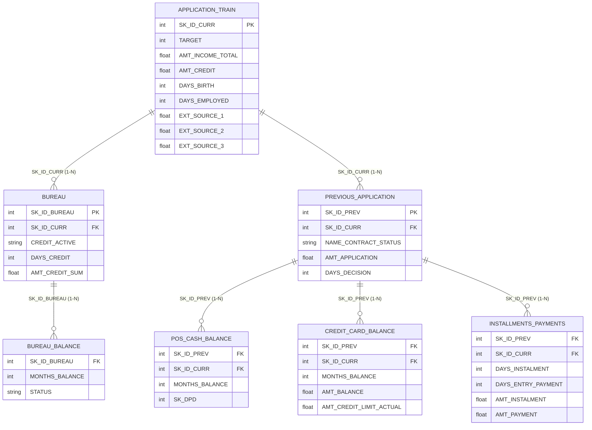
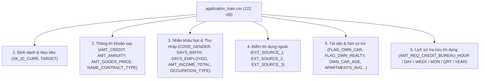
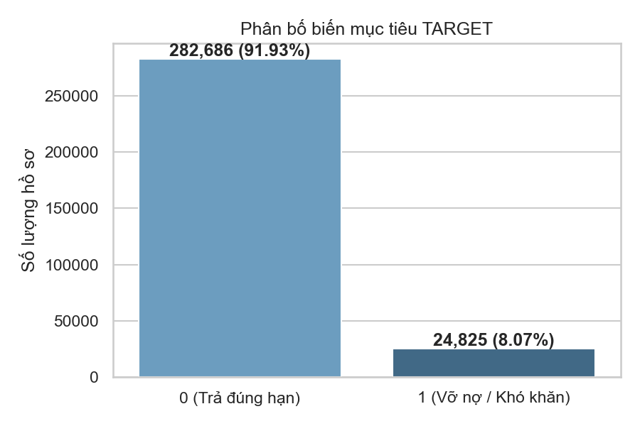
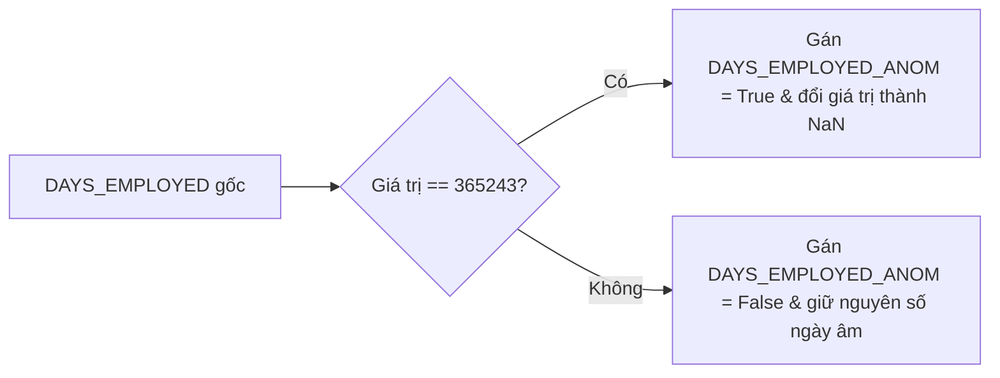
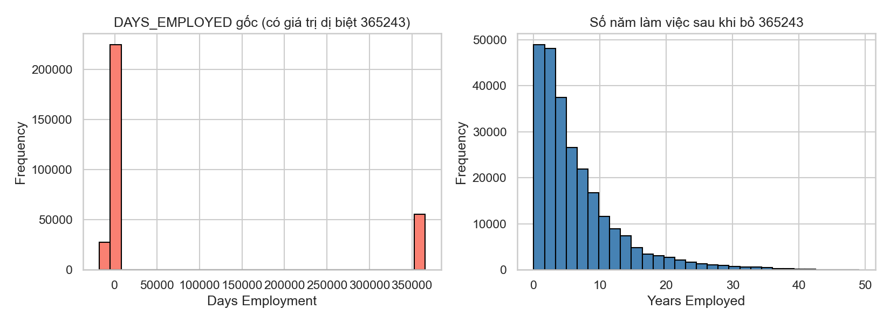
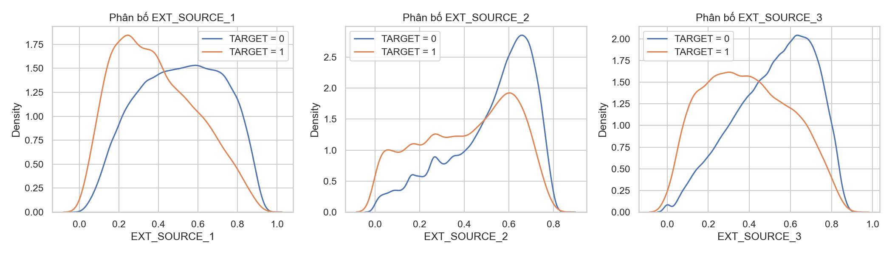
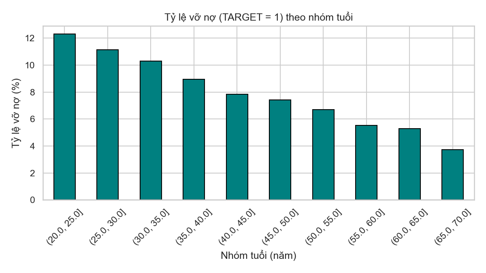

# Báo cáo Đánh giá EDA: Home Credit Default Risk

> **Tài liệu tham chiếu:** *Start Here: A Gentle Introduction* — Will Koehrsen ([Kaggle Notebook](https://www.kaggle.com/code/willkoehrsen/start-here-a-gentle-introduction))  
> **Bộ dữ liệu trọng tâm:** `application_train.csv` (Home Credit Default Risk)  
---

## 1. Giải thích dữ liệu

Bộ **Home Credit Default Risk** là một hệ dữ liệu quan hệ gồm **7 bảng** (bảng chính chứa hồ sơ xin vay hiện tại và 6 bảng phụ chứa lịch sử tín dụng quá khứ tại Home Credit cũng như các tổ chức tín dụng khác):

| Bảng dữ liệu | Vai trò | Khóa nối chính |
| :--- | :--- | :--- |
| **`application_train.csv` / `application_test.csv`** | Bảng chính chứa thông tin tĩnh của từng hồ sơ xin vay tại thời điểm nộp đơn ($t = 0$) và nhãn `TARGET`. | `SK_ID_CURR` (khóa chính) |
| **`bureau.csv`** | Lịch sử các khoản vay trước đây của khách hàng tại **các tổ chức tín dụng khác** (báo cáo từ Credit Bureau). | `SK_ID_CURR`, `SK_ID_BUREAU` |
| **`bureau_balance.csv`** | Trạng thái thanh toán **hàng tháng** của từng khoản vay trong `bureau.csv`. | `SK_ID_BUREAU` |
| **`previous_application.csv`** | Lịch sử các lần nộp đơn xin vay **trước đây tại Home Credit** (được duyệt, từ chối hay hủy). | `SK_ID_CURR`, `SK_ID_PREV` |
| **`POS_CASH_balance.csv`** | Số dư hàng tháng của các khoản vay tiền mặt / trả góp điểm bán (POS) trước đây tại Home Credit. | `SK_ID_PREV`, `SK_ID_CURR` |
| **`credit_card_balance.csv`** | Số dư và hạn mức hàng tháng của thẻ tín dụng trước đây tại Home Credit. | `SK_ID_PREV`, `SK_ID_CURR` |
| **`installments_payments.csv`** | Lịch sử **từng kỳ thanh toán** (ngày đến hạn `DAYS_INSTALMENT` vs. ngày trả thực `DAYS_ENTRY_PAYMENT`, số tiền phải trả vs. đã trả). | `SK_ID_PREV`, `SK_ID_CURR` |

### 1.1. Sơ đồ quan hệ giữa các bảng dữ liệu (ER Diagram)

### 1.2. Giải thích các nhóm thuộc tính trong bảng chính (`application_train.csv`)

122 cột trong `application_train.csv` được chia thành **6 nhóm thuộc tính nghiệp vụ**:

- **Nhóm khoản vay:** Phản ánh quy mô và áp lực trả nợ (`AMT_CREDIT` = tổng tiền vay, `AMT_ANNUITY` = tiền góp định kỳ, `AMT_GOODS_PRICE` = giá trị hàng hóa).
- **Nhóm nhân khẩu học & việc làm:** Đánh giá độ ổn định tài chính (`DAYS_BIRTH`, `DAYS_EMPLOYED`, `AMT_INCOME_TOTAL`, `NAME_INCOME_TYPE`, `NAME_EDUCATION_TYPE`).
- **Nhóm điểm tín dụng bên ngoài (`EXT_SOURCE_1/2/3`):** Điểm chuẩn hóa từ các tổ chức chấm điểm tín dụng đối tác — là nhóm có sức dự báo mạnh nhất.
- **Nhóm tài sản & nơi ở:** Phản ánh tài sản đảm bảo và điều kiện sống (nhóm này có tỷ lệ thiếu `NaN` cao nhất, 50–70%).
- **Nhóm tra cứu tín dụng (`AMT_REQ_CREDIT_BUREAU_*`):** Số lần khách hàng bị tổ chức tài chính tra cứu hồ sơ tín dụng trước khi nộp đơn (tra cứu quá dày trong thời gian ngắn thường là dấu hiệu khát vốn/rủi ro).

---

## 2. Tổng quan cấu trúc & Phân bố biến mục tiêu (`TARGET`)

- **Quy mô bảng chính (`application_train.csv`):** **307,511** hồ sơ vay × **122** cột (gồm `SK_ID_CURR`, nhãn `TARGET` và 120 đặc trưng đầu vào).
- **Biến mục tiêu (`TARGET`):**
  - `TARGET = 0` (Trả nợ đúng hạn): **282,686** mẫu (**~91.93%**).
  - `TARGET = 1` (Gặp khó khăn thanh toán / Vỡ nợ): **24,825** mẫu (**~8.07%**).

### Đánh giá:
- Dữ liệu có sự **mất cân bằng lớp rõ rệt** (tỷ lệ xấp xỉ **11.4 : 1**).
- Do đó, không thể dùng `Accuracy` đơn thuần để đánh giá mô hình; cần ưu tiên **Balanced Accuracy**, **Recall / F1 trên lớp `1`** (hoặc **ROC-AUC**).

---

## 3. Phân tích dữ liệu thiếu (Missing Values)

- Nhiều đặc trưng trong `application_train.csv` bị thiếu dữ liệu ở mức cao (**50% – 70%**), tập trung chủ yếu ở nhóm thông tin mô tả nơi ở/tòa nhà (ví dụ `COMMONAREA_*`, `NONLIVINGAPARTMENTS_*`, `FLOORSMIN_*`, `YEARS_BUILD_*`, `OWN_CAR_AGE`, `EXT_SOURCE_1`).
- **Hướng xử lý được đề xuất trong EDA:**
  - *Với mô hình tuyến tính / Random Forest (scikit-learn):* Bắt buộc điền khuyết (`SimpleImputer(strategy='median')`) trước khi chuẩn hóa (`MinMaxScaler` / `StandardScaler`).
  - *Với mô hình Gradient Boosting hiện đại (LightGBM, XGBoost, CatBoost):* Có thể giữ nguyên `NaN` để thuật toán tự học nhánh phân chia tối ưu cho giá trị thiếu (vì bản thân việc thiếu thông tin đôi khi cũng mang tín hiệu rủi ro).

---

## 4. Kiểu dữ liệu & Mã hóa biến phân loại (Categorical Encoding)

Các cột `object` (biến phân loại dạng chuỗi) được chia làm 2 nhóm để xử lý tối ưu:
1. **Biến nhị phân (2 giá trị duy nhất, ví dụ `NAME_CONTRACT_TYPE`, `FLAG_OWN_CAR`, `FLAG_OWN_REALTY`):** Dùng **Label Encoding** (`0` / `1`) để không làm phình số chiều.
2. **Biến đa lớp ($\ge 3$ giá trị, ví dụ `NAME_INCOME_TYPE`, `NAME_EDUCATION_TYPE`, `OCCUPATION_TYPE`):** Dùng **One-Hot Encoding (`pd.get_dummies`)**, sau đó căn chỉnh cột (`align`) giữa tập Train và Test để đảm bảo đồng nhất số lượng đặc trưng.

---

## 5. Phát hiện & Xử lý bất thường (`DAYS_EMPLOYED` & `DAYS_BIRTH`)

Tất cả các cột `DAYS_*` trong Home Credit đều là **số ngày đếm lùi tính từ thời điểm nộp đơn (`t = 0`)**:

- **`DAYS_BIRTH` (Tuổi khách hàng):** Khi chia cho `-365`, độ tuổi phân bố hợp lý trong khoảng **20 – 70 tuổi**, không có giá trị dị biệt.
- **`DAYS_EMPLOYED` (Số ngày làm việc tại công việc hiện tại):** Xuất hiện giá trị bất thường **`365243`** (tương đương ~1,000 năm đi làm — thực chất là mã đánh dấu hồ sơ không đi làm / nghỉ hưu / thiếu thông tin).

### Đánh giá:
- Nếu không xử lý giá trị `365243`, các phép tính trung bình, độ lệch chuẩn và bộ chuẩn hóa (`StandardScaler` / `MinMaxScaler`) sẽ bị kéo lệch nghiêm trọng.
- Cách xử lý chuẩn: **giữ lại cột cờ `DAYS_EMPLOYED_ANOM`** (vì nhóm có giá trị `365243` thường có tỷ lệ vỡ nợ khác biệt) và **thay `365243` bằng `np.nan`**.

---

## 6. Phân tích tương quan & Các đặc trưng quan trọng nhất

### 6.1. Nhóm điểm tín dụng bên ngoài (`EXT_SOURCE_1`, `EXT_SOURCE_2`, `EXT_SOURCE_3`)
- Đây là **3 biến có tương quan âm mạnh nhất với `TARGET`** trong toàn bộ bảng `application_train.csv`.
- **Quy luật quan sát được từ biểu đồ KDE:** Điểm `EXT_SOURCE` càng thấp, xác suất khách hàng rơi vào nhóm `TARGET = 1` (vỡ nợ) càng cao.

### 6.2. Yếu tố độ tuổi (`DAYS_BIRTH / -365`)
- Có **tương quan dương với `TARGET`** (vì `DAYS_BIRTH` là số âm: giá trị càng gần `0` nghĩa là khách hàng càng trẻ → tỷ lệ vỡ nợ càng cao).
- Khi chia độ tuổi thành từng nhóm 5 năm (`20–25`, `25–30`, ..., `65–70`), biểu đồ tỷ lệ vỡ nợ giảm đều từ nhóm trẻ nhất xuống nhóm lớn tuổi nhất.

---

## 7. Tạo đặc trưng nghiệp vụ (Domain Feature Engineering)

Từ kết quả EDA, notebook đề xuất thêm các tỷ lệ tài chính có ý nghĩa trực tiếp trong thẩm định tín dụng:
- `CREDIT_INCOME_PERCENT = AMT_CREDIT / AMT_INCOME_TOTAL` (Tỷ lệ khoản vay trên thu nhập)
- `ANNUITY_INCOME_PERCENT = AMT_ANNUITY / AMT_INCOME_TOTAL` (Áp lực trả góp hàng kỳ trên thu nhập)
- `CREDIT_TERM = AMT_ANNUITY / AMT_CREDIT` (Hệ số kỳ hạn trả nợ)
- `DAYS_EMPLOYED_PERCENT = DAYS_EMPLOYED / DAYS_BIRTH` (Tỷ lệ thời gian đi làm trên tuổi đời)

---

## 8. Kết luận đánh giá EDA cho dự án của nhóm

1. **Mức độ phù hợp:** Bộ `Home Credit Default Risk` xác định rõ thời điểm dự đoán tại **$t = 0$ (lúc nộp đơn)**, không bị rò rỉ thông tin hậu giải ngân.
2. **Việc cần đưa vào pipeline dùng chung (`src/data_loader.py`):**
   - Bắt buộc xử lý bất thường `DAYS_EMPLOYED == 365243` → `NaN` + cột cờ `DAYS_EMPLOYED_ANOM`.
   - Giữ lại các đặc trưng mạnh từ EDA (`EXT_SOURCE_1/2/3`, tuổi, các biến tỷ lệ tài chính) và có thể mở rộng ghép thêm lịch sử trả góp quá khứ từ `installments_payments.csv` qua `SK_ID_CURR`.
   - Khi chia Train/Test, sử dụng `stratify=y` để bảo toàn tỷ lệ mất cân bằng ~91.93% / ~8.07%.
