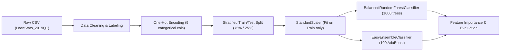

# Báo cáo Dự án Machine Learning: Dự đoán Rủi ro Tín dụng (Credit Risk Prediction)

> **Mục tiêu đề tài:** Áp dụng kiến thức Machine Learning đã học để tự thiết kế, xây dựng và đánh giá một mô hình dự đoán rủi ro tín dụng hoàn chỉnh trên dữ liệu tài chính thực tế có độ mất cân bằng lớp cao.

---

## Phân bổ nội dung & Tiêu chí đánh giá

| Thành phần | Tỷ trọng | Nội dung chính |
| :--- | :---: | :--- |
| **1. Introduction** | 10% | Giới thiệu bài toán, động lực và mục tiêu |
| **2. Dataset** | 20% | Mô tả bộ dữ liệu, đặc trưng, phân bố lớp và tiền xử lý |
| **3. Methodology & Experiment** | 25% | Phương pháp, kiến trúc mô hình và thiết lập thí nghiệm |
| **4. Evaluation & Result** | 25% | Bộ chỉ số đánh giá, kết quả thực nghiệm và phân tích |
| **5. Conclusion & Future Work** | 10% | Kết luận tổng hợp và hướng phát triển tiếp theo |
| **6. Time Management** | 10% | Kế hoạch triển khai dự án và phân bổ thời lượng thuyết trình |

---

## 1. Introduction — Giới thiệu bài toán, động lực và mục tiêu (10%)

### 1.1. Bối cảnh và bài toán
Trong hoạt động cho vay của các ngân hàng và tổ chức tài chính (Fintech / P2P Lending), **đánh giá rủi ro tín dụng (Credit Risk Assessment)** là bài toán cốt lõi nhằm dự đoán khả năng người vay không thể hoàn trả khoản vay đúng hạn. Bài toán được mô hình hóa dưới dạng **phân loại nhị phân (Binary Classification)**:
- **`low_risk`**: Khoản vay đang thanh toán đúng hạn (`Current`).
- **`high_risk`**: Khoản vay có dấu hiệu trễ hạn hoặc vỡ nợ (`Late (16-30 days)`, `Late (31-120 days)`, `In Grace Period`, `Default`).

### 1.2. Động lực
- **Thiệt hại bất đối xứng:** Bỏ sót một khoản vay rủi ro cao (*False Negative*) có thể gây mất toàn bộ gốc và lãi, lớn hơn rất nhiều so với chi phí thẩm định bổ sung một hồ sơ tốt bị cảnh báo nhầm (*False Positive*).
- **Thách thức mất cân bằng lớp cực đoan (Extreme Class Imbalance):** Trong dữ liệu thực tế, các khoản vay rủi ro cao chỉ chiếm khoảng **0.5%**. Các mô hình học máy tiêu chuẩn tối ưu theo *Accuracy* sẽ dễ dàng dự đoán toàn bộ là `low_risk` để đạt độ chính xác 99.5% nhưng hoàn toàn thất bại trong việc phát hiện rủi ro.

### 1.3. Mục tiêu
1. Xây dựng một quy trình (pipeline) xử lý dữ liệu và huấn luyện Machine Learning hoàn chỉnh từ dữ liệu thô.
2. Áp dụng và so sánh hai kiến trúc Ensemble chuyên dụng cho dữ liệu mất cân bằng: **`BalancedRandomForestClassifier`** và **`EasyEnsembleClassifier`**.
3. Tối ưu khả năng phát hiện khoản vay rủi ro cao (ưu tiên **Recall lớp `high_risk`** và **Balanced Accuracy**), đồng thời phân tích các đặc trưng quan trọng ảnh hưởng đến rủi ro tín dụng.

---

## 2. Dataset — Bộ dữ liệu sử dụng (20%)

### 2.1. Tổng quan dữ liệu
- **Nguồn dữ liệu:** LendingClub Loan Data — Quý 1/2019 (`LoanStats_2019Q1.csv`).
- **Quy mô ban đầu:** ~115,678 bản ghi khoản vay với 144 thuộc tính gốc.
- **Đặc trưng được lựa chọn:** **86 cột** bao gồm:
  - *Thông tin khoản vay:* `loan_amnt`, `int_rate`, `installment`, `issue_d`, `pymnt_plan`, `initial_list_status`.
  - *Thông tin tài chính & nhân khẩu học:* `annual_inc`, `home_ownership`, `verification_status`, `dti`, `application_type`.
  - *Lịch sử tín dụng & thanh toán:* `delinq_2yrs`, `inq_last_6mths`, `open_acc`, `pub_rec`, `revol_bal`, `total_rec_prncp`, `total_rec_int`, `last_pymnt_amnt`, `total_pymnt`, `mort_acc`,...
  - *Biến mục tiêu:* `loan_status`.

### 2.2. Quy trình tiền xử lý dữ liệu (Data Preprocessing)
1. **Đọc dữ liệu sạch:** Bỏ dòng ghi chú đầu file (`skiprows=1`) và 2 dòng tổng kết cuối file (`[:-2]`).
2. **Xử lý giá trị thiếu:** Loại bỏ các cột có toàn bộ giá trị `NaN` (`dropna(axis='columns', how='all')`) và các dòng chứa giá trị thiếu (`dropna()`).
3. **Lọc bản ghi hợp lệ:** Loại bỏ các khoản vay có trạng thái `Issued` (mới giải ngân, chưa phát sinh kỳ thanh toán).
4. **Chuẩn hóa kiểu dữ liệu:** Chuyển `int_rate` từ chuỗi phần trăm (ví dụ `" 17.19%"`) sang dạng số thực thập phân (`0.1719`).
5. **Gán nhãn nhị phân:**
   - `Current` → `low_risk`
   - `Late (31-120 days)`, `Late (16-30 days)`, `Default`, `In Grace Period` → `high_risk`
6. **Mã hóa biến phân loại (One-Hot Encoding):** Áp dụng `pd.get_dummies(..., drop_first=True)` cho 9 biến dạng chuỗi (`home_ownership`, `verification_status`, `issue_d`, `pymnt_plan`, `initial_list_status`, `next_pymnt_d`, `debt_settlement_flag`, `application_type`, `hardship_flag`).

### 2.3. Phân bố lớp sau tiền xử lý
Dữ liệu sau làm sạch có khoảng **68,817 mẫu** (tập kiểm thử 25% gồm **17,205 mẫu**):

| Lớp (`loan_status`) | Số lượng trên tập Test (25%) | Tỷ lệ |
| :--- | :---: | :---: |
| `low_risk` | 17,118 | **99.49%** |
| `high_risk` | 87 | **0.51%** |
| **Tổng cộng** | **17,205** | **100%** |

> **Nhận xét:** Tỷ lệ mất cân bằng xấp xỉ **197 : 1**. Đây là lý do bắt buộc phải dùng chia tập phân tầng (*Stratified Split*) và các kỹ thuật Ensemble kết hợp tái lấy mẫu (*Resampling*).

---

## 3. Method & Experiment — Phương pháp, mô hình và thiết lập thí nghiệm (25%)

### 3.1. Kiến trúc Pipeline tổng thể

### 3.2. Mô hình sử dụng

#### Mô hình 1: Balanced Random Forest Classifier (`BalancedRandomForestClassifier`)
- **Cơ chế:** Mở rộng từ Random Forest truyền thống. Với mỗi cây quyết định trong rừng, thuật toán thực hiện **Random Under-Sampling** trên lớp đa số (`low_risk`) trong tập bootstrap để tạo ra tập con cân bằng 1:1 với lớp thiểu số (`high_risk`).
- **Ưu điểm:** Khắc phục thiên lệch lớp ngay trong quá trình huấn luyện từng cây mà không vứt bỏ thông tin của lớp đa số trên toàn cục; đồng thời tính toán trực tiếp **Feature Importance**.
- **Siêu tham số thí nghiệm:** `n_estimators=1000`, `random_state=1`.

#### Mô hình 2: Easy Ensemble Classifier (`EasyEnsembleClassifier`)
- **Cơ chế:** Kết hợp **Bagging** và **AdaBoost**. Thuật toán sinh ra `n_estimators` tập con cân bằng (mỗi tập gồm toàn bộ lớp thiểu số + một phần lấy mẫu ngẫu nhiên không hoàn lại từ lớp đa số), huấn luyện một bộ phân loại **AdaBoost** trên mỗi tập con rồi tổng hợp phiếu bầu.
- **Ưu điểm:** Giảm đồng thời sai số (*bias*) nhờ AdaBoost và phương sai (*variance*) nhờ Bagging trên nhiều tập con; hoạt động đặc biệt hiệu quả khi tỷ lệ mất cân bằng rất cao.
- **Siêu tham số thí nghiệm:** `estimator=None` (mặc định `AdaBoostClassifier`), `n_estimators=100`, `sampling_strategy='auto'`, `replacement=False`, `n_jobs=1`, `random_state=1`.

### 3.3. Thiết lập thí nghiệm (Experimental Setup)
- **Chia dữ liệu:** `train_test_split(X, y, random_state=1, stratify=y)` (75% Train ≈ 51,612 mẫu; 25% Test = 17,205 mẫu).
- **Chuẩn hóa dữ liệu:** `StandardScaler` được `fit` duy nhất trên `X_train` và áp dụng `transform` lên cả `X_train` và `X_test` nhằm tránh rò rỉ dữ liệu (*data leakage*).
- **Môi trường thực thi:** Python 3.11.9 (`.venv`), `pandas`, `numpy`, `scikit-learn`, `imbalanced-learn`.

---

## 4. Evaluation & Result — Đánh giá và kết quả đạt được (25%)

### 4.1. Tiêu chí đánh giá
Do dữ liệu mất cân bằng cực đoan (99.49% `low_risk`), bài toán không dùng *Accuracy* làm thước đo chính mà tập trung vào:
- **Balanced Accuracy:** $\frac{1}{2}(\text{Recall}_{\text{high\_risk}} + \text{Recall}_{\text{low\_risk}})$.
- **Recall (Sensitivity) của lớp `high_risk`:** Tỷ lệ khoản vay rủi ro cao được mô hình phát hiện đúng.
- **Precision & F1-score:** Đánh giá mức độ cảnh báo nhầm và sự cân bằng giữa Precision và Recall.

### 4.2. Kết quả thực nghiệm của `EasyEnsembleClassifier` (Tập Test: 17,205 mẫu)

- **Balanced Accuracy:** **0.8999 (89.99%)**
- **Overall Accuracy:** **0.94 (94.00%)**

| Lớp | Precision | Recall | F1-score | Support |
| :--- | :---: | :---: | :---: | :---: |
| **`high_risk`** | 0.07 | **0.86** | 0.12 | 87 |
| **`low_risk`** | **1.00** | 0.94 | 0.97 | 17,118 |
| **Macro avg** | 0.53 | **0.90** | 0.54 | 17,205 |
| **Weighted avg** | 0.99 | 0.94 | 0.96 | 17,205 |

### 4.3. Top 10 đặc trưng quan trọng nhất (từ `BalancedRandomForestClassifier`)

| Hạng | Đặc trưng (Feature) | Độ quan trọng (Importance) | Ý nghĩa nghiệp vụ |
| :---: | :--- | :---: | :--- |
| 1 | `total_rec_prncp` | 0.0753 | Tổng tiền gốc đã thu hồi đến hiện tại |
| 2 | `total_rec_int` | 0.0646 | Tổng tiền lãi đã thu hồi |
| 3 | `last_pymnt_amnt` | 0.0645 | Số tiền của kỳ thanh toán gần nhất |
| 4 | `total_pymnt_inv` | 0.0605 | Tổng thanh toán phân bổ cho nhà đầu tư |
| 5 | `total_pymnt` | 0.0584 | Tổng số tiền đã thanh toán đến hiện tại |
| 6 | `int_rate` | 0.0287 | Lãi suất khoản vay |
| 7 | `issue_d_Jan-2019` | 0.0239 | Thời điểm phát hành khoản vay (Tháng 1/2019) |
| 8 | `dti` | 0.0177 | Tỷ lệ nợ trên thu nhập (*Debt-to-Income*) |
| 9 | `installment` | 0.0176 | Số tiền phải trả hàng tháng |
| 10 | `annual_inc` | 0.0163 | Thu nhập hàng năm của người vay |

### 4.4. Phân tích kết quả
- **Điểm mạnh:** Mô hình `EasyEnsembleClassifier` đạt **Balanced Accuracy ~90%** và phát hiện được **86% khoản vay `high_risk`** (~75/87 hồ sơ rủi ro), đồng thời giữ Precision = **1.00** và Recall = **0.94** trên lớp `low_risk`. Điều này chứng minh hiệu quả vượt trội của kỹ thuật Bagging + AdaBoost kết hợp under-sampling so với mô hình học máy thông thường.
- **Đánh đổi (Precision–Recall Trade-off):** Precision trên lớp `high_risk` đạt **0.07** do số lượng `low_risk` quá lớn (6% bị phân loại nhầm trên 17,118 mẫu tương đương ~1,027 hồ sơ *False Positive*). Trong nghiệp vụ ngân hàng, hệ thống có thể dùng mô hình này như **bộ lọc cảnh báo sớm (Early Warning System)** để chuyển các hồ sơ nghi ngờ sang bước thẩm định chuyên sâu.

---

## 5. Conclusion — Kết luận (10%)

- Dự án đã hoàn thành toàn bộ quy trình xây dựng mô hình Machine Learning cho bài toán **Dự đoán rủi ro tín dụng**: từ tiền xử lý dữ liệu thô, xử lý mất cân bằng lớp, chuẩn hóa, huấn luyện mô hình Ensemble đến đánh giá bằng các chỉ số chuyên biệt.
- **`EasyEnsembleClassifier`** cho hiệu năng nổi bật với **Balanced Accuracy = 89.99%** và **Recall `high_risk` = 86%**, đáp ứng tốt mục tiêu hạn chế bỏ sót các khoản vay có nguy cơ vỡ nợ.
- **`BalancedRandomForestClassifier`** cung cấp cái nhìn trực quan về các yếu tố tác động mạnh nhất đến rủi ro tín dụng (lịch sử thanh toán gần nhất, lãi suất, tỷ lệ DTI và thu nhập).

---

## 6. Future Work — Hướng phát triển tiếp theo

1. **Tách biệt bài toán thẩm định trước giải ngân (Origination Scoring):** Hiện tại Top 5 đặc trưng quan trọng nhất đều là thông tin phát sinh *sau* khi khoản vay đã giải ngân (`total_rec_prncp`, `last_pymnt_amnt`,...). Hướng mở rộng là loại bỏ nhóm biến này để xây dựng mô hình dự đoán rủi ro ngay tại thời điểm khách hàng nộp hồ sơ vay.
2. **Thử nghiệm thêm thuật toán & tối ưu siêu tham số:** So sánh thêm **XGBoost**, **LightGBM**, **CatBoost** với trọng số lớp (`scale_pos_weight`) hoặc **SMOTEENN**, kết hợp `StratifiedKFold` Cross-Validation và tối ưu ngưỡng quyết định (*Threshold Tuning*) theo hàm chi phí tài chính để nâng cao Precision/F1-score.
3. **Giải thích mô hình (Explainable AI):** Tích hợp **SHAP** để giải thích rõ lý do từng hồ sơ bị xếp loại `high_risk`, đáp ứng yêu cầu minh bạch trong ngành tài chính.
4. **Triển khai ứng dụng thực tế:** Đóng gói pipeline (`scikit-learn Pipeline` + `joblib`) và xây dựng giao diện web (Streamlit / FastAPI) cho phép nhân viên tín dụng nhập hồ sơ và nhận điểm rủi ro theo thời gian thực.

---

## 7. Time Management — Quản lý thời gian (10%)

### 7.1. Tiến độ thực hiện dự án
| Giai đoạn | Thời gian dự kiến | Công việc chính |
| :--- | :---: | :--- |
| Tuần 1 | 20% | Xác định bài toán, thu thập dữ liệu `LoanStats_2019Q1.csv`, khám phá dữ liệu (EDA) |
| Tuần 2 | 25% | Làm sạch dữ liệu, xử lý giá trị thiếu, gán nhãn `low_risk`/`high_risk`, mã hóa đặc trưng |
| Tuần 3 | 30% | Xây dựng & huấn luyện `BalancedRandomForestClassifier` và `EasyEnsembleClassifier`, gỡ lỗi môi trường/phiên bản thư viện |
| Tuần 4 | 25% | Đánh giá kết quả, phân tích Feature Importance, hoàn thiện notebook & báo cáo trình bày |

### 7.2. Phân bổ thời lượng thuyết trình (mẫu 10 phút)
| Phần trình bày | Tỷ trọng điểm | Thời lượng | Mục tiêu kiểm soát thời gian |
| :--- | :---: | :---: | :--- |
| **Introduction** | 10% | 1.0 phút | Nêu rõ bài toán, con số mất cân bằng 0.5% và mục tiêu |
| **Dataset** | 20% | 2.0 phút | Trình bày nguồn dữ liệu, 86 đặc trưng và 6 bước tiền xử lý |
| **Methodology & Experiment** | 25% | 2.5 phút | Giải thích sơ đồ pipeline và nguyên lý 2 mô hình Ensemble |
| **Evaluation & Result** | 25% | 2.5 phút | Tập trung vào Balanced Accuracy (89.99%), Recall (86%), Top Features & trade-off |
| **Conclusion & Future Work** | 10% | 1.0 phút | Chốt kết quả đạt được và 4 hướng mở rộng thực tế |
| **Time Managing & Q&A** | 10% | 1.0 phút | Dự phòng chuyển slide, giữ đúng tiến độ và trả lời câu hỏi |
